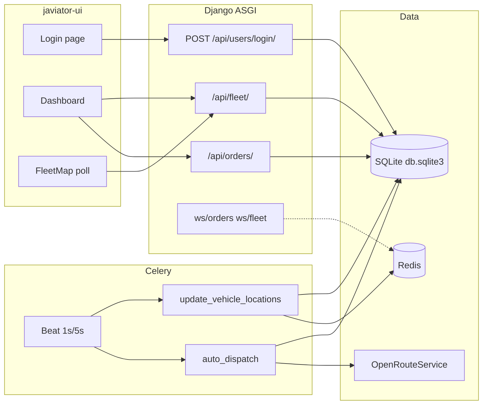
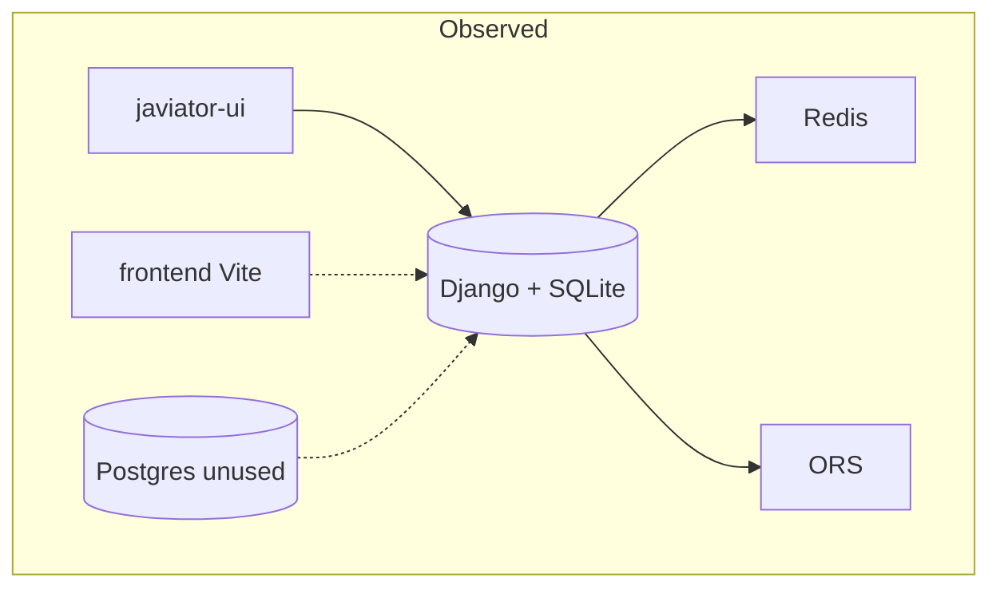
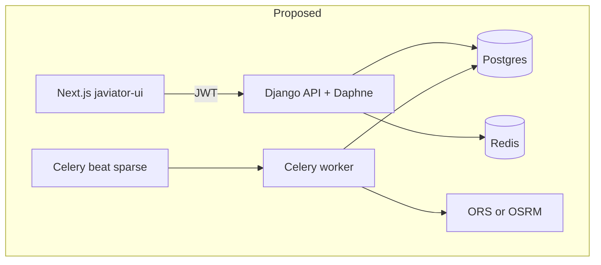

# Javiator — Project Production Readiness Report

**Audit date:** 2026-10-25
**Repository:** `J:/Javiator` (git branch `main`)
**Scope:** Read-only inspection of source, configuration, migrations, frontends, Docker files, and git history.
**Not executed:** application startup, Docker Compose, Celery workers, database migrations, test suite, load tests, or live OpenRouteService calls. Runtime claims are labeled **unverified**.

**Scoring methodology (used in the scorecard):**
Each category is rated **Poor / Needs Improvement / Good / Strong** based on evidence in the repository, not on the presence of a technology name.

| Rating | Meaning |
| --- | --- |
| Poor | Missing, unsafe, or contradicted by the code; would fail a production or interview review |
| Needs Improvement | Present but incomplete, incorrect, mocked, or not wired end-to-end |
| Good | Implemented with reasonable structure; gaps remain for production |
| Strong | Production-grade, tested, and operationally complete |

No overall percentage is assigned. Maturity is described qualitatively: **early-stage demo / prototype control tower, not a production B2B logistics product**.

---

## 1. Executive Summary

Javiator is a **local demonstration of a logistics control-tower UI** backed by Django REST Framework, JWT login, Celery beat loops, Redis Channels, and OpenRouteService (ORS) road geometries. The intended product (AI-powered B2B logistics and multi-vehicle route optimization) is **not implemented**. What exists is a simulation: vehicles step along a polyline, orders change status by progress percentage, and a weighted heuristic is labeled “AI.”

### Overall maturity

**Prototype / demo.** Suitable as a visual portfolio of a dark “operations” dashboard. Not suitable for real customers, multi-tenant operations, or claims of production AI routing.

### Architectural strengths

1. **Clear Django app split** (`accounts`, `fleet`, `orders`, `dispatch`, `tracking`, `analytics`, `notifications`) matching a logistics domain.
2. **A real (if simple) dispatch path:** pending order → vehicle selection → ORS polyline → Celery movement simulation → WebSocket/HTTP polling in the UI (`dispatch/services.py`, `tracking/tasks.py`, `javiator-ui`).
3. **JWT login exists** (`users/views.py` `login_view`) and Django password hashing via `User.objects.create_user` in `accounts/serializers.py`.
4. **Next.js UI (`javiator-ui`)** has a coherent control-tower layout, TypeScript, role *presentation* flags, Leaflet map, and tables for vehicles/orders.
5. **Docker Compose** names the right *kinds* of processes (web, worker, beat, Redis, Postgres) even though they are not correctly integrated.

### Five most important weaknesses

1. **Security is not production-safe:** hardcoded Django `SECRET_KEY` with `DEBUG = True` and `ALLOWED_HOSTS = ["*"]` (`backend/config/settings.py`); **committed OpenRouteService API key** (`backend/dispatch/routing.py`); Postgres password `admin` in `docker-compose.yml`; self-service **role assignment** on register; RBAC classes unused on APIs; WebSockets accept any client.
2. **“AI” and analytics are mock or heuristic:** `dispatch/ai_dispatch.py` is a weighted formula; `analytics/views.py` returns hardcoded numbers; `AIinsights.tsx` is static copy; `getCurrentUser()` returns a hardcoded manager.
3. **Data and deploy story is inconsistent:** Django uses **SQLite**; Compose runs **Postgres that the app never uses**; `makemigrations` runs at container start; fleet/order **migration histories were rewritten** (git status shows many deletions vs new `0002_initial.py`).
4. **No automated tests, no CI, no root README, no Kubernetes, no PostGIS.** All `tests.py` files are empty stubs.
5. **Broken or mismatched contracts** between UI and API (KPI field names, analytics payload, WebSocket group names, `/me` unused, `accounts` URLs not mounted, missing map icons).

### Five highest-impact next steps

1. Remove secrets from git; load config from environment; disable debug in non-local environments; restrict hosts and CORS.
2. Finish authentication: mount register/`/me`, return role from login, stop mocking the current user, enforce permissions on every endpoint and WebSocket.
3. Point Django at Postgres (or drop unused Postgres); freeze a **clean migration graph**; stop `makemigrations` in Compose.
4. Treat dispatch as a **deterministic assignment + ORS geometry** product; add tests; do not market it as AI until a real model or solver exists.
5. Add a CI pipeline (lint + Django tests + frontend typecheck) and a root README that describes the real demo workflow honestly.

### Main risks preventing production deployment

- Credential leakage and unauthenticated/over-privileged APIs.
- SQLite vs advertised Postgres; no backups, pooling, or HA.
- Beat tasks every 1–5 seconds calling an external routing API (cost, rate limits, duplicate dispatch).
- No tenant isolation, no driver/customer identity model, no idempotent jobs.
- Zero test/CI gate.

### Most valuable feature to prioritize

A **correct, tested, single-tenant dispatch loop**: create order → assign feasible vehicle with capacity/fuel checks → persist a road route → simulate or ingest GPS → update status with transactions → show it on the map. That loop is the product. Optimization solvers and ML should come after the loop is honest and measured.

### Recommendation for the next stage of development

**Phase A (critical corrections)** only: secrets, auth wiring, permission enforcement, database alignment, migration freeze, contract fixes between UI and API. Do not add Kubernetes, PostGIS, OR-Tools, or predictive ML until the demo path is secure, consistent, and tested.

---

## 2. Project Overview and Intended Product Scope

### Stated intent

A full-stack, AI-powered **B2B logistics and route optimization** platform for transportation operations, fleet monitoring, and operational decisions.

### Observed product

A **single-tenant simulation dashboard** centered on Bengaluru-ish default coordinates (`Vehicle.current_lat` default `12.9716`). Users can log in (if a Django user exists), CRUD vehicles and orders, and watch Celery move vehicles along an ORS polyline. Roles exist as a string on `accounts.User` and as **UI visibility flags**, not as enforced business isolation.

### Sensible product scope (recommended)

For one developer and a credible portfolio/commercial MVP:

| In scope | Out of scope until later |
| --- | --- |
| One organization (single tenant) | Multi-tenant SaaS isolation |
| Vehicles, drivers (as users), orders (pickup/drop) | Full TMS/WMS, invoicing, customs |
| Assignment + road geometry + live map | City-scale VRP with hundreds of vehicles |
| Dispatcher UI + client tracking of *their* orders | Predictive demand ML |
| Celery for movement/dispatch | Kubernetes, service mesh |
| Postgres | PostGIS until spatial queries are real |

Google Maps is **not** in the repository. Routing uses **OpenRouteService**. Maps tiles use **Carto/OSM** via Leaflet.

---

## 3. Repository Structure and Architecture

### 3.1 Major directories

| Path | Responsibility |
| --- | --- |
| `backend/` | Django project (`config`), domain apps, `manage.py`, `requirements.txt`, `Dockerfile` |
| `backend/config/` | Settings, URLs, ASGI/WSGI, Celery app |
| `backend/accounts/` | Custom user, register/`me` views (URLs **not** included in root urls) |
| `backend/users/` | JWT **login** view; leftover `User` model **not** in `INSTALLED_APPS` |
| `backend/fleet/` | Vehicle model, CRUD, KPIs, movement simulation endpoint, fleet WebSocket |
| `backend/orders/` | Order model, CRUD ViewSet, order WebSocket |
| `backend/dispatch/` | Assignment, ORS client, heuristic “AI” score, Celery `auto_dispatch`, unused delivery simulator |
| `backend/tracking/` | Celery location updater; unused `VehicleConsumer` / `ws/vehicles/` |
| `backend/analytics/` | Hardcoded dashboard JSON |
| `backend/notifications/` | In-app notification model and APIs |
| `backend/staticfiles/` | Collected Django/DRF admin assets (should not be treated as app source) |
| `javiator-ui/` | Primary frontend: Next.js 16 + React 19 + TypeScript + Tailwind 4 |
| `frontend/` | Older Vite + React Leaflet map; **wrong API path**; no auth |
| `docker-compose.yml` | web (Daphne), Celery worker/beat, Redis, Postgres |
| `docs/` | This report (created by the audit) |

**Absent:** `.github/workflows`, Kubernetes/Helm, Terraform, root `README.md`, `.env.example`, PostGIS, OR-Tools, pytest config.

### 3.2 Important files

| File | Purpose |
| --- | --- |
| `backend/config/settings.py` | Security, SQLite, JWT, Channels Redis host `redis`, Celery beat |
| `backend/config/urls.py` | HTTP API mount points (no `accounts`, no SimpleJWT refresh views) |
| `backend/config/asgi.py` | HTTP + WebSocket (`fleet` + `orders` routing only) |
| `backend/config/celery.py` | Celery app; **overwrites** beat schedule (auto-dispatch every **1s**) |
| `backend/dispatch/services.py` | `assign_vehicle` — core business logic |
| `backend/dispatch/routing.py` | ORS HTTP client + hardcoded key |
| `backend/dispatch/ai_dispatch.py` | Heuristic score (not ML) |
| `backend/tracking/tasks.py` | Simulated GPS along `route_data` |
| `javiator-ui/app/page.tsx` | Dashboard shell |
| `javiator-ui/app/login/page.tsx` | Login against `/api/users/login/` |
| `javiator-ui/services/auth.ts` | **Mocks** current user as manager “Jay” |
| `docker-compose.yml` | Process topology; DB unused by Django settings |

### 3.3 Backend architecture (observed)

Monolithic Django 5.2 (requirements) / migrations stamped **Django 6.0.4** — version drift. Domain apps, DRF `ModelViewSet`s, Celery tasks, Channels consumers. **No repository layer.** Business logic lives in `dispatch/services.py` and `tracking/tasks.py`. `dispatch/views.py` and `tracking/views.py` are empty stubs.

### 3.4 Frontend architecture (observed)

Two UIs:

1. **`javiator-ui` (canonical):** App Router, one main page plus `/login`. Client components fetch REST with `fetch` + Bearer token. Polling (2–8s) plus one order WebSocket helper. No global state library. RBAC in `lib/roles.ts` is **UI-only**.
2. **`frontend/`:** Vite prototype calling `GET /api/vehicles/` which **does not exist** (actual path is `/api/fleet/vehicles/`). No JWT.

### 3.5 Data flow (high level)

See §5.

### 3.6 External services

| Service | Where | Status |
| --- | --- | --- |
| OpenRouteService directions | `dispatch/routing.py` `get_route` | Implemented; key hardcoded; no timeout/retry/cache |
| Redis | Channels + Celery broker | Configured for Docker hostname `redis` |
| Carto basemaps | `javiator-ui/app/styles/theme.ts` | Optional `NEXT_PUBLIC_CARTO_API_KEY` |
| Google Maps | — | **Absent** |
| Postgres | Compose only | **Not used by Django** |

### 3.7 Runtime dependencies (declared)

**Python (`backend/requirements.txt`):** Django 5.2.4, DRF, SimpleJWT, django-cors-headers, Channels, channels-redis, Celery, Redis, requests, polyline, psycopg2-binary, python-dotenv (unused in settings), Daphne.

**Node (`javiator-ui/package.json`):** next 16.2.4, react 19, leaflet, recharts, lucide-react, tailwind 4.

**Node (`frontend/package.json`):** vite, react-leaflet, axios.

**Images:** `python:3.11`, `redis:7`, `postgres:15`.

### 3.8 Startup and execution flow (intended via Compose)

1. `docker-compose.yml` `web` runs `makemigrations && migrate && daphne -b 0.0.0.0 -p 8000 config.asgi:application`.
2. `worker`: `celery -A config worker --loglevel=info --pool=solo`.
3. `beat`: `celery -A config beat --loglevel=info`.
4. Redis and Postgres start; Django still opens `backend/db.sqlite3`.
5. Beat fires `tracking.tasks.update_vehicle_locations` and `dispatch.tasks.auto_dispatch`.
6. UI (`next dev`) talks to `http://127.0.0.1:8000`.

**Unverified:** whether Compose actually boots on this machine.

**Local without Docker:** Redis hostname `redis` in settings will fail on a host-only run unless `/etc/hosts` or a compose network is used.

### 3.9 Existing deployment architecture

Docker Compose **development** topology only. No K8s, no ingress, no TLS, no CI deploy, no healthchecks in Compose, bind-mount `./backend:/app`, Redis and Postgres **published to the host**.

### 3.10 Missing or unclear elements

- Which frontend is official (evidence: `javiator-ui` is far more complete).
- How a first user is created (no seed, register URL unmounted, no documented `createsuperuser`).
- Whether Channels Redis is required for HTTP-only demo (yes for WS; HTTP polling still works).
- Why `users.User` still exists alongside `AUTH_USER_MODEL = "accounts.User"`.

---

## 4. Actual Technology Stack and Implementation Status

| Technology | Status | Where | Notes |
| --- | --- | --- | --- |
| Python / Django | Implemented | `backend/` | Settings unsafe for prod |
| DRF | Implemented | ViewSets, `@api_view` | No versioning, pagination, throttling |
| React | Implemented | `javiator-ui`, `frontend` | Duplicate UIs |
| TypeScript | Partial | `javiator-ui` only | Loose `any` in `orderSocket.ts` |
| PostgreSQL | Configured unused | `docker-compose.yml` | Django engine is sqlite3 |
| PostGIS | **Absent** | — | Float lat/lng only |
| Redis | Configured | settings Channels/Celery | Host hardcoded `redis` |
| Celery | Implemented | beat + worker tasks | Aggressive schedules; no retries/idempotency |
| Docker Compose | Partial | root compose + `backend/Dockerfile` | Dev-oriented; root process; `makemigrations` |
| Kubernetes | **Absent** | — | Not useful at this maturity |
| Google Maps | **Absent** | — | ORS + Leaflet instead |
| JWT | Partial | login issues tokens | No refresh endpoint mounted; blacklist app missing |
| AI/ML | **Not present** | Labels only | Heuristic + hardcoded copy |
| OR-Tools | **Absent** | — | — |
| Channels / WebSockets | Partial | ASGI + consumers | Group name mismatch; session auth not JWT |
| python-dotenv | Declared unused | requirements | Settings do not load `.env` |

---

## 5. End-to-End Application Data Flow

### Login (works in code path; runtime unverified)

1. `javiator-ui/app/login/page.tsx` POST `http://127.0.0.1:8000/api/users/login/`.
2. `users/views.py` `login_view` uses Django `authenticate`, returns SimpleJWT access/refresh + `username` **without `role`**.
3. Tokens stored in `localStorage`.
4. Home page requires `access` token then calls `getCurrentUser()` which **ignores the API** and returns a mock manager (`javiator-ui/services/auth.ts`).
5. Dashboard RBAC therefore **always behaves as manager** after login, regardless of `accounts.User.role`.

### Create order → dispatch → map

1. `AddOrderModal` POST `/api/orders/` with lat/lng/weight (`status: "created"`).
2. `OrderViewSet` saves `orders.Order` if authenticated.
3. Celery beat `dispatch.tasks.auto_dispatch` loads `status="created"` and calls `assign_vehicle(order.id)`.
4. `assign_vehicle` scores vehicles, calls `get_route` twice (vehicle→pickup, pickup→drop), writes `Vehicle.route_data`, sets `is_moving=True`, `is_available=False`, assigns the order and nearby unassigned orders by haversine cluster + capacity.
5. `update_vehicle_locations` advances `route_index` by **8 points** per tick, updates fuel/ETA/progress, broadcasts Channels groups `fleet_tracking` and `order_tracking`.
6. UI map **polls** `/api/fleet/vehicles/` and `/api/orders/` every 3s (`FleetMap.tsx`). Order table may also open `ws://127.0.0.1:8000/ws/orders/`.

### Broken links in this path

- `OrderConsumer` joins group `"orders"` (`orders/consumers.py`) but tracking sends `"order_tracking"` (`tracking/tasks.py`). **Order WebSocket updates will not arrive** unless something else sends to `"orders"` (nothing does).
- `tracking/routing.py` `ws/vehicles/` is **not** included in `config/asgi.py`.
- Fleet WS (`ws/fleet/`, group `fleet_tracking`) matches sends, but **the UI does not connect** to it; it polls HTTP instead.
- If ORS fails, `get_route` returns `[]`; vehicle is still marked moving with empty route; tracker `continue`s and never completes.



---

## 6. Feature Completeness Matrix

Classification keys: **Functional** (code exists and is wired; runtime unverified), **Untested**, **Partial**, **Placeholder/mock**, **Missing**, **N/A**.

| # | Capability | Classification | Evidence |
| --- | --- | --- | --- |
| 1 | Registration / auth | **Partial** | Login wired (`users/urls.py`). Register/`me` exist in `accounts/` but **not** in `config/urls.py`. No password reset. JWT refresh not exposed. |
| 2 | Organization / tenant | **Missing** | No Organization/Company model. |
| 3 | RBAC | **Partial / UI-only** | `accounts.User.role`; `accounts/permissions.py` unused. APIs `IsAuthenticated` only. UI mocks role. |
| 4 | Customer/client management | **Missing** | `customer_name` / `customer_phone` strings on `Order`, no Customer entity, no FK to client user. |
| 5 | Fleet / vehicles | **Functional, untested** | `Vehicle` + `VehicleViewSet`. Simulate endpoint mutates all vehicles randomly. |
| 6 | Driver management | **Partial** | `driver_name` CharField, not `accounts.User`. |
| 7 | Shipment / delivery | **Partial** | `Order` is a point-to-point shipment. No multi-stop job, POD, or exceptions beyond `cancelled` choice unused in simulator. |
| 8 | Pickup/delivery locations | **Partial** | Lat/lng required; addresses optional; no geocoding. |
| 9 | Route planning / optimization | **Partial** | Nearest/heuristic assignment + ORS A→B geometry. Not VRP. |
| 10 | Geocoding / distance | **Partial** | Haversine in `dispatch/utils.py` and duplicated in `ai_dispatch.py`. No geocoder. |
| 11 | Delivery assignment | **Partial** | Automatic via beat; no manual assign API; race-prone; cluster reuse logic is dead (see §11). |
| 12 | Dispatch workflows | **Placeholder** | UI “Dispatch hub” shows selected vehicle telemetry; no dispatcher actions. |
| 13 | Status tracking | **Partial** | Status driven by route **progress %** (30/60/100), not geofence. |
| 14 | Failed delivery / exceptions | **Missing** | No failed/return/reschedule. `success_rate` forced to 100 on complete. |
| 15 | Fleet dashboards / analytics | **Placeholder** | Real-ish KPIs in `fleet_kpis` with **wrong field names vs UI**; analytics dashboard **hardcoded**. |
| 16 | History / audit | **Missing** | No audit log; `print()` only. |
| 17 | Notifications | **Partial, untested** | Model + APIs; created in `auto_dispatch`; high-utilization alert can **spam** every tick. |
| 18 | Reporting / exports | **Missing** | — |
| 19 | Background processing | **Partial** | Celery used for simulation, not for long optimization jobs. |
| 20 | Admin interfaces | **Partial** | Django admin for User, Vehicle, Order, Notification. |

---

## 7. Backend Audit

### Organization

Apps map to domains. Duplication: `users` vs `accounts`; empty `dispatch.models`; empty analytics/dispatch/tracking views; `delivery_simulator.py` **never imported** (grep: definition only).

### DRF usage

- `VehicleViewSet` / `OrderViewSet`: full CRUD, `fields = "__all__"` on vehicles — clients can overwrite telemetry, scores, `route_data`.
- Default permission `IsAuthenticated` globally — good baseline — but **no object-level** filters: any user sees all orders/vehicles.
- Notifications endpoints rely on default permission (authenticated) but perform **no user scoping**.
- No `DEFAULT_PAGINATION_CLASS`, `DEFAULT_FILTER_BACKENDS`, `DEFAULT_THROTTLE_CLASSES`.
- No API version prefix (`/api/v1/`).
- No custom exception handler; ORS and dispatch use `print` and swallow errors.

### Business logic

`assign_vehicle` is the core. Issues:

- No `transaction.atomic`; vehicle saved before cluster assignment.
- Nearby-order “reuse vehicle” iterates orders from `find_nearby_orders`, which only returns **unassigned** `created` orders — `o.assigned_vehicle` is always falsy. Dead code.
- Clustered extra orders share one vehicle but **do not extend the polyline**; only the primary order’s pickup/drop is routed.
- ETA is `distance * 3` minutes (magic number), later overwritten by remaining polyline points × 0.05 km / speed.
- `ai_dispatch_score` field on Order is never written in `assign_vehicle`.

### Transactions / idempotency

`auto_dispatch` every 1s (celery.py) can double-assign under concurrency (no `select_for_update`). Notifications for failed dispatch created every cycle for the same order. High fleet utilization notification has **no duplicate guard** (unlike fuel alerts).

### Configuration

Hardcoded secrets and hosts. `python-dotenv` unused. Channels/Celery assume Docker DNS name `redis`. SQLite file DB with Compose Postgres leftover.

### External integration

`get_route`: `requests.post` **without timeout**; logs full JSON body (`print(data)`); returns `[]` on any error.

### Scalability / maintainability

- Haversine clustering is O(orders²) in Python.
- `fleet_kpis` does `sum(vehicle.fuel_level for vehicle in vehicles)` after `.all()` — loads full table.
- Beat every 1–5s is a demo pattern, not an operations pattern.
- Extremely sparse vertical spacing in Python files reduces reviewability.

---

## 8. Frontend Audit

### `javiator-ui` (primary)

**Strengths:** Distinct visual system (`app/styles/*`), layout shell, dark/light, Leaflet isolation via `dynamic(..., { ssr: false })`, tables with search, modals to create vehicles/orders, notification dropdown wired to APIs.

**Architecture issues:**

- Single mega-page (`app/page.tsx`); Sidebar nav items are **not routes** (`active` hardcoded on Fleet).
- Mixed API clients: `apiFetch` vs raw `fetch("http://127.0.0.1:8000/...")` in tables/modals/login — no env-based API URL.
- Auth: token in `localStorage` (XSS-sensitive); no refresh rotation despite SimpleJWT `ROTATE_REFRESH_TOKENS = True`.
- `getCurrentUser` mock makes RBAC a **fiction**.
- `normalizeRole` defaults unknown roles to `"manager"` (`types/user.ts`) — privilege inflation in UI.
- KPI mapping expects `moving_vehicles` / `low_fuel_vehicles`; API returns `moving_now` / `low_fuel` (`fleet/views.py` vs `page.tsx`).
- Analytics UI expects `leaderboard`, `ai_insights`, `completed_orders`, etc.; API returns five hardcoded keys (`analytics/views.py`). Charts will be empty/wrong (**unverified in browser**).
- `AIinsights.tsx`: static strings (Vehicle 4, Electronic City, Outer Ring Road).
- No Error Boundary, no React Query/SWR (manual intervals, overlapping polls).
- Accessibility: custom inputs without associated `htmlFor` on some forms; no skip links; map not keyboard-operable.
- Missing public icons: `FleetMap.tsx` references `/icons/delivery-truck.svg` and `/icons/pickup.svg`; `javiator-ui/public/icons/` only has `drop.svg`.
- No frontend tests.

### `frontend/` (legacy)

Vite Leaflet demo, polls `/api/vehicles/` (404 vs current backend). **Should be removed or clearly marked archived** to avoid onboarding confusion.

### TypeScript

Beneficial and already in use in `javiator-ui`. Completing types and a shared API client would help more than adding Redux.

---

## 9. Database and PostGIS Audit

### Engine

`DATABASES['default']['ENGINE'] = django.db.backends.sqlite3` (`settings.py`). `psycopg2-binary` is unused. **PostGIS is not installed or referenced.**

### Schema (realistic logistics?)

**Weak for real operations:**

- No tenant, depot, region, time windows, service duration, or address geocode cache.
- Driver is a string; Vehicle has no unique plate/VIN; no FK integrity to a Driver user.
- Order has no client user, no pieces/SKU, no proof of delivery, no cancellation reason.
- Geospatial as `FloatField` without check constraints (lat −90..90) or spatial indexes.
- JSON `route_data` unbounded; no size limit.
- Almost **no indexes** besides PK (`db_index` grep only username unique).
- `Vehicle.capacity` vs `Order.weight` unconstrained (negative weights possible).
- Circular FK Vehicle.current_order ↔ Order.assigned_vehicle — valid but easy to desync (tracker clears one side).

### Migrations

Git **tracks** a long chain of fleet/order `alter_id` migrations. Working tree **deletes** those and adds squashed `0001`/`0002_initial` plus later order migrations. This is unsafe for any existing database and for collaborators.

`docker-compose` runs **`makemigrations` on every start** — non-deterministic schema drift; never do this in production.

Migrations mention Django **6.0.4** while requirements pin **5.2.4**.

### Backup / connections

No `CONN_MAX_AGE`, no pgbouncer, no backup docs. SQLite + bind mount is a local demo only.

---

## 10. Redis and Celery Audit

### What runs

| Task | Schedule (settings.py) | Schedule (celery.py) | Role |
| --- | --- | --- | --- |
| `tracking.tasks.update_vehicle_locations` | 5.0s | 5.0s | Simulate GPS |
| `dispatch.tasks.auto_dispatch` | 5.0s | **1.0s** | Assign + notify |

`celery.py` sets `app.conf.beat_schedule` **after** `config_from_object`, so **1 second auto-dispatch wins** if that module is used.

Worker: `--pool=solo` (Windows-friendly, one process). No `task_acks_late`, `task_time_limit`, retries, or result backend configured (`CELERY_RESULT_BACKEND` absent).

### Issues

- **Not idempotent.** Duplicate beat + overlapping `assign_vehicle`.
- **ORS on the hot path** of a 1s loop → quota/cost/latency.
- Failed tasks: default Celery logging only; no dead-letter.
- Redis 7 image with **no persistence config** and port 6379 exposed.
- `celerybeat-schedule` **binary file is committed** (`backend/celerybeat-schedule`) — runtime artifact.

### Sync vs async (recommendation)

| Synchronous | Asynchronous |
| --- | --- |
| CRUD, login, KPI reads | ORS route fetch |
| Validation | Multi-vehicle optimization |
| Manual assign (when added) | GPS ingest / simulation ticks |
| | Notification fan-out, reports |

Simulation ticks every 5s are fine for a **demo**. Production GPS should be pushed by devices, not invented in Celery.

---

## 11. Route Optimization and AI/ML Audit

### What exists

1. **Haversine** distance (`dispatch/utils.py`, duplicate in `ai_dispatch.py`).
2. **Greedy vehicle pick:** lowest `calculate_ai_score` among available vehicles with fuel > 10 and capacity ≥ weight (`dispatch/services.py`, `ai_dispatch.calculate_ai_score`).
3. **Score formula:** `0.35*distance + 0.20*(1-fuel%) + 0.15*(1-capacity/1000) + 0.15*(1-speed/100) + 0.15*1.2`. Constant traffic `1.2`. **Not learned, not optimized, not a VRP solver.**
4. **ORS driving-car directions** for two legs; polyline decoded to lat/lng list.
5. **Cluster:** other unassigned orders within 5 km pickup radius packed by weight onto the same vehicle **without routing them**.

### Direct answers

| Question | Answer |
| --- | --- |
| Algorithm | Greedy weighted heuristic + external directions API |
| Real optimizer? | **No** |
| Multi-vehicle VRP? | **No** (one order at a time, one polyline) |
| Capacity | Soft check per vehicle; cluster packing; no volume/axis |
| Time windows | **No** |
| Pickup-delivery pairing constraints | Implicit one pickup then one drop for primary order only |
| Traffic | Constant 1.2; later `traffic_delay_minutes = eta * 0.1` |
| Infeasibility | Returns `None`; notification spam |
| Determinism | Unstable (beat timing, ORS, float, vehicle queryset order) |
| Scale | Fine for tens of vehicles; not hundreds of stops |
| Async optimization job | **No** (sync inside beat task) |
| Cache | **No** |
| Tests | **None** |
| Quality vs baseline | **Not measured** |

**There is no substantive vehicle-routing optimization algorithm in this repository.** There is no ML training data, pipeline, or model artifact.

### Recommended technical direction

**Formulation:** start with **single-vehicle TSP / two-point routing** (already close to current data model: one pickup, one drop). When multiple orders share a vehicle, upgrade to **VRP with pickup-and-delivery (PDP)** and optional **capacity (CVRP)**. Time windows (VRPTW) only after `Order` has `ready_time` / `due_time`.

**OR-Tools** is appropriate **after** (1) Postgres + tests, (2) a stop list model, (3) async jobs. Do not add it only for the résumé.

**Phased approach**

1. **Baseline:** nearest available feasible vehicle + ORS (document as such); golden tests with mocked ORS.
2. **Constraints:** capacity, fuel for full trip, max stops, no assign if route empty.
3. **Measure:** total km vs nearest-neighbor; p95 ORS latency; infeasible rate.
4. **Cost:** fuel model with units, not `fuel_consumed * 1.25`.
5. **Re-optimize:** on new high-priority order or vehicle breakdown — Celery task with lock.
6. **ML:** only with historical on-time data (ETA residual model). Not LLMs for routing.

**Do not call the current score “AI.”** Rename to `dispatch_score`.

---

## 12. Security Findings

Secrets are **not reproduced** below. Rotate anything that was committed.

### S1 — Hardcoded Django `SECRET_KEY`, `DEBUG=True`, `ALLOWED_HOSTS=["*"]`

- **Severity:** Critical
- **Component:** `backend/config/settings.py`
- **Evidence:** `SECRET_KEY = "django-insecure-..."`, `DEBUG = True`, `ALLOWED_HOSTS = ["*"]`
- **Impact:** Session/JWT signing key in git; debug traces; host header attacks.
- **Remediation:** Env vars; `DEBUG` from env; explicit hosts. Rotate key.
- **Verify:** `manage.py diffsettings` in a prod-like env; confirm DEBUG false.

### S2 — OpenRouteService API key committed

- **Severity:** Critical
- **Component:** `backend/dispatch/routing.py` `ORS_API_KEY`
- **Evidence:** Literal JWT-like key in source
- **Impact:** Quota theft, billing, key revocation required.
- **Remediation:** Revoke key at ORS; load from env; never commit. Restrict key if ORS supports HTTP referrer/IP.
- **Verify:** New key only in env; git history purge if the repo is or will be public.

### S3 — Database credentials in Compose

- **Severity:** High
- **Component:** `docker-compose.yml` `POSTGRES_PASSWORD: admin`, ports `5432:5432` and `6379:6379`
- **Impact:** Trivial remote access if host is reachable. Django currently unused for Postgres, but the container still runs.
- **Remediation:** Secrets file / env; do not publish DB/Redis to `0.0.0.0` in production.

### S4 — Client-controlled role on registration

- **Severity:** High
- **Component:** `accounts/serializers.py` `RegisterSerializer` includes `role`
- **Impact:** Anyone could register as `admin` **if** the route is mounted. Currently unmounted — still a landmine.
- **Remediation:** Force `role="client"` on public signup; admin-only role changes.

### S5 — APIs authenticated but not authorized (IDOR / data bleed)

- **Severity:** High
- **Component:** `fleet/views.py`, `orders/views.py`, `notifications/views.py`
- **Evidence:** `queryset = Model.objects.all()`; `FleetAccessPermission` unused
- **Impact:** Any logged-in client/driver reads and mutates all fleet/orders; clients can DELETE vehicles.
- **Remediation:** Role + object scoping; clients only own orders; drivers only assigned vehicles.
- **Verify:** Test matrix per role (does not exist today).

### S6 — WebSockets unauthenticated for data

- **Severity:** High
- **Component:** `fleet/consumers.py`, `orders/consumers.py`; `AuthMiddlewareStack` is **session** cookie, not JWT
- **Impact:** Anonymous clients can `connect()` and receive live order/fleet payloads if they guess the path.
- **Remediation:** JWT query/subprotocol auth; reject anonymous; tenant rooms.

### S7 — JWT blacklist enabled without app

- **Severity:** Medium
- **Component:** `SIMPLE_JWT["BLACKLIST_AFTER_ROTATION"] = True` without `rest_framework_simplejwt.token_blacklist` in `INSTALLED_APPS`; no `/token/refresh/` URL
- **Impact:** Rotation/blacklist **does not work**; refresh unused by UI. Logout only deletes localStorage.

### S8 — CORS / CSRF local-only

- **Severity:** Medium (prod)
- **Component:** `CORS_ALLOWED_ORIGINS` localhost list; `CORS_ALLOW_CREDENTIALS = True`
- **Impact:** Fine for local; must not ship as-is. Tokens are header-based so CSRF on JWT APIs is lower risk; admin/session still needs CSRF.

### S9 — Simulate endpoint is a write bomb

- **Severity:** Medium
- **Component:** `fleet/views.py` `simulate_vehicle_movement`
- **Impact:** Any authenticated user randomizes **all** vehicles’ positions and fuel — demo backdoor.

### S10 — Logging of ORS payloads / PII

- **Severity:** Medium
- **Component:** `dispatch/routing.py` `print(data)`; dispatch `print` of orders
- **Impact:** Coordinates and API errors in stdout; no redaction.

### S11 — XSS surface

- **Severity:** Low–Medium
- **Component:** React generally escapes; `localStorage` tokens stolen by any XSS. No CSP headers in Next/Django.
- **Remediation:** CSP, httpOnly cookies (with CSRF strategy) or short-lived access tokens.

### S12 — SQL injection

- **Severity:** Informational (likely safe)
- **Evidence:** ORM only; no raw SQL found in app modules (staticfiles excluded).

### S13 — Container privileges

- **Severity:** Medium
- **Component:** `backend/Dockerfile` `FROM python:3.11`, runs as root, `CMD runserver` (Compose overrides with Daphne)
- **Impact:** No non-root user; fat image; no healthcheck.

### S14 — Dependency vulnerabilities

- **Severity:** Informational
- **Evidence:** Not scanned in this audit (no CI). `requirements.txt` is fully pinned — good — but no `pip-audit`/`npm audit` in pipeline.

**Confirmed vs potential:** S1–S4, S7, S9, S11 (architecture) are **confirmed in source**. S5/S6 impact is **confirmed by code** (missing checks); exploitation **unverified** at runtime.

---

## 13. Testing and Code Quality

### Existing suite

Every app `tests.py` is:

```python
from django.test import TestCase
# Create your tests here.
```

No pytest, no frontend tests, no CI.

**Tests were not executed** (empty; no claim of pass/fail beyond “stubs contain no cases”).

### Quality issues (non-test)

- Duplicate User models; duplicate haversine; dead `delivery_simulator`.
- Magic numbers (route_index += 8, fuel 0.3, distance 0.4 km/tick).
- Emoji-heavy logs; no `logging` config in settings.
- UI/API contract drift.

### Practical testing pyramid (recommended)

| Layer | Target | Examples |
| --- | --- | --- |
| Unit | Dispatch score, haversine, capacity reject | `calculate_ai_score`, `calculate_score` inf cases |
| API | Authz matrix | Anonymous 401; client cannot DELETE vehicle |
| Integration | Assign + mocked ORS | `responses`/`unittest.mock` on `get_route` |
| Task | Tracker completion | Empty route; index past end |
| Frontend | Login redirect; order create validation | Playwright later, one happy path |
| E2E | One Compose demo script | Create order → assigned → delivered |

**Do not chase % coverage.** Cover dispatch, permissions, and ORS failure.

---

## 14. Performance and Scalability

No measurements were taken. The following are **design bottlenecks**, not benchmarks.

- Beat 1s × N pending orders × 2 ORS HTTP calls.
- Full table polls every 2–5s from multiple components (map, tables, KPIs, analytics).
- Unpaginated `OrderViewSet` / `VehicleViewSet`.
- WebSocket + poll duplication once groups are fixed.
- SQLite write contention from beat + HTTP.
- Frontend: Leaflet + polling; `react-leaflet-tracking-marker`; no virtualized tables.

**Before concluding capacity** (hundreds of users, thousands of shipments): load-test assign+list endpoints; measure ORS p95; count queries with Django Debug Toolbar / `assertNumQueries`.

**Appropriate improvements now:** pagination; `select_related("assigned_vehicle")`; stop analytics interval if mocked; debounce map fetches; cache ORS by coordinate hash; lock dispatch with Redis.

**Do not** split microservices or add a cache cluster until the demo is correct.

---

## 15. Docker, Kubernetes, and Deployment Review

### Dockerfile

- Single-stage `python:3.11` (not slim).
- Root user; copies whole backend (including `staticfiles`).
- Default `runserver` — inappropriate; Compose uses Daphne (good).
- No `HEALTHCHECK`.

### Compose

- `makemigrations` at start: **unsafe**.
- Bind mounts: dev convenience, not prod.
- `depends_on` without health/ready conditions.
- Postgres unused by app.
- No frontend service.
- Redis/Postgres ports exposed.

### Kubernetes

**None.** At current maturity K8s adds cost and noise. Prefer Compose locally and a single-VM or PaaS deploy first.

---

## 16. Cloud Architecture Recommendations

### Minimum viable production (one region, single tenant)

- **Compute:** One small VM or ECS/Fargate **service** for Daphne + one worker + one beat, **or** Render/Fly/Railway equivalent.
- **DB:** Managed Postgres (RDS/Cloud SQL).
- **Redis:** Managed ElastiCache/Memorystore **or** Redis Cloud (tiny).
- **Frontend:** Vercel or same origin behind Nginx.
- **Secrets:** AWS Secrets Manager / Doppler / platform env.
- **TLS:** Managed cert on load balancer / Caddy.
- **Backups:** Managed Postgres PITR.
- **CI:** GitHub Actions → tests → build image → deploy.

Kubernetes is **optional later** when you need multiple environments, autoscaling workers, or team-owned infra-as-code.

### Indicative cost (estimates, not quotes)

Assumptions: low demo traffic, us-east, always-on:

| Item | Rough monthly USD |
| --- | --- |
| t3.small or 1× Fargate 0.5 vCPU + RDS db.t4g.micro | 30–80 |
| Redis 1GB | 15–30 |
| ORS / maps | 0–50 depending on beat abuse |
| Traffic/TLS | 5–15 |

**Estimate only.** Fix the 1s ORS loop before any cloud spend.

### AWS sketch (later)

ALB → ECS service (web) + ECS service (worker/beat) → RDS Postgres → ElastiCache Redis → S3 if media. No EKS until ops need it.

---

## 17. Observability and Reliability

**Observed:** `print()` in tasks/consumers; Django default logging; no health URL; no metrics; no tracing; no Sentry.

**Operator story today:** SSH/docker logs and hope. Queue depth unknown. ORS failures become empty routes.

### Practical stack

- JSON logs (`structlog` or django logging formatter) with `request_id`.
- `/healthz` (process up) and `/readyz` (DB + Redis ping).
- Sentry for Django + Next.js.
- Celery Events / Flower **or** Prometheus `django-prometheus` + Redis exporter — only after health endpoints.
- Uptime check on `/readyz`.

### Metrics to add (definitions)

| Metric | Calculation | Instrumentation |
| --- | --- | --- |
| Dispatch success rate | assigned / (assigned+failed) per window | counter in `assign_vehicle` |
| Optimization duration | time `get_route` + assign | histogram |
| Delivery completion | delivered / created | SQL daily |
| On-time | need promised vs `delivered_at` — **field missing** | add SLA timestamp first |
| Distance vs baseline | assigned km vs haversine | store both |
| API error rate | 5xx / requests | access log |
| p95 latency | request timing | middleware |
| Task failure rate | Celery task-failed / total | worker events |

Do not publish fake “96% ETA accuracy” (`analytics/views.py`).

---

## 18. Frontend UX and Product Quality

The Next.js UI **looks** like a B2B control tower (typography, glass/dark panels, map-first). It does **not** yet behave like one:

- Nav does not navigate.
- AI insights are advertising copy.
- Role experience is mocked.
- Client panel loads **all** orders (`ClientTrackingPanel` `/api/orders/`).
- Driver “My route” is selected vehicle from the **global** map, not “this driver’s vehicle.”
- Forms ask for raw lat/lng — dispatchers will not do this in production (need address search).
- Destructive deletes in tables: need confirmation audit (partially icon-based; not fully reviewed line-by-line).
- Login claims “Route optimization · predictive ETA · operational AI” — **overclaim**.

**Improve first:** (1) truthful login/session, (2) order create with map click/geocode, (3) live assignment feedback, (4) empty/error states on tables when API shape is wrong, (5) drop legacy Vite app from the product story.

Browser E2E verification was **not** performed in this audit (read-only, no running stack assumed).

---

## 19. CI/CD and Developer Experience

| Area | Status |
| --- | --- |
| Root README | **Missing** |
| UI READMEs | Create-next-app / Vite boilerplate |
| `.github/` | **Missing** |
| Lint | ESLint configs exist; not gated |
| Format | No ruff/black/prettier config found |
| Env sample | **Missing** |
| Seed data | **Missing** |
| `celerybeat-schedule` in git | Noise |
| `staticfiles/` in tree | Noise |
| Migration churn | High (git status) |
| Branching | Only `main` observed |

### Recommended CI (every PR)

1. `ruff` + Django `manage.py test` (once tests exist) with SQLite CI settings.
2. `javiator-ui`: `npm ci && npx tsc --noEmit && npm run lint`.
3. Secret scan (gitleaks) — would fail today.
4. Do **not** run `makemigrations --check` until history is frozen.

Periodic: `pip-audit`, `npm audit`, image build.

---

## 20. Technical Debt and Architectural Risks

1. Dual frontends and dual user apps.
2. Simulation mixed with “production” models (fuel, carbon, efficiency formulas without units).
3. WebSocket group/name mismatches.
4. Beat-driven ORS as architecture center.
5. Migration rewrite vs git history.
6. Over-labeling AI.
7. Compose Postgres vs SQLite split-brain.
8. Committed secrets and beat schedule file.
9. `BLACKLIST_AFTER_ROTATION` without blacklist app.
10. UI contracts (KPI/analytics) not matching serializers.

---

## 21. Recommended Target Architecture

**Retain:** Django monolith, DRF, SimpleJWT, Celery, Redis, Next.js UI, Leaflet, ORS (or OSRM later), Postgres.

**Refactor:** settings via env; one auth app; one frontend; dispatch service with transactions and mocked-ORS tests; Channels JWT auth; serializers that match UI.

**Replace:** hardcoded analytics; mock `getCurrentUser`; heuristic marketed as AI.

**Remove:** Vite `frontend/` (or `/legacy`); `users.models.User`; unused tracking consumer until needed; `makemigrations` in Compose; committed `staticfiles` and `celerybeat-schedule`.

**Do not add:** K8s, Kafka, PostGIS, LLM agents, microservices.

### Observed vs proposed





**Auth boundary:** login/register/`me`/refresh; permissions in DRF; WS same user.

**Failure handling:** ORS timeout → order stays `created`, retry with backoff, user-visible error; never mark `is_moving` without points.

**Testing:** pytest/Django tests as gate; Playwright smoke on login+create order against Compose.

---

## 22. Prioritized Implementation Roadmap

Adapted to this repo. No Kubernetes phase. ML deferred.

### Phase A — Critical corrections (P0)

Secrets, debug, auth wiring, permission deny-by-default, DB/migration freeze, contract bugs, revoke ORS key.

### Phase B — Reliable core product (P1)

Real `/me` role, scoped querysets, transactions, pagination, honest analytics from ORM, seed demo data, tests for dispatch and authz.

### Phase C — Logistics optimization (P1–P2)

Mockable routing port; empty-route handling; optional OR-Tools PDP when stop list exists; async job + UI status.

### Phase D — Production readiness (P1–P2)

CI, Compose prod overlay, healthchecks, logging/Sentry, managed Postgres, backups, pip-audit.

### Phase E — Differentiation (P2–P3)

True dispatcher workflow, geocoding, benchmarks vs baseline, client-scoped tracking, ETA model only with data.

---

## 23. Task-Level Implementation Backlog

Effort assumes **one experienced developer** familiar with Django/React. Hours are order-of-magnitude.

| Task ID | Task | Current problem | Proposed solution | Priority | Category | Dependencies | Effort | Complexity | Acceptance criteria | Verification | Expected outcome |
| --- | --- | --- | --- | --- | --- | --- | --- | --- | --- | --- | --- |
| P0-01 | Remove secrets; env-based settings | Hardcoded SECRET_KEY, ORS key, DEBUG, `*` hosts | `django-environ`; `.env.example`; revoke ORS key | P0 | Security | — | 4–8h | Low | No secrets in git; prod DEBUG false | gitleaks; greps | Safe to share repo |
| P0-02 | Stop exposing Redis/Postgres; drop default passwords | Compose ports + `admin` | Internal network only; strong password via env | P0 | DevOps | P0-01 | 2h | Low | Ports not published in prod overlay | `docker compose config` | Reduced attack surface |
| P0-03 | Mount auth routes; implement `/me`; return role on login | `accounts.urls` unused; mock user | Include `api/auth/`; login serializer with role; UI uses `/me` | P0 | Backend/Frontend | — | 1d | Medium | UI role matches DB | Manual login + pytest | Honest RBAC |
| P0-04 | Enforce permissions on all APIs | `IsAuthenticated` only | Use/adapt `FleetAccessPermission`; queryset scoping | P0 | Security | P0-03 | 1–2d | Medium | Client cannot list others’ orders or mutate fleet | API tests | IDOR reduced |
| P0-05 | JWT WS auth; fix group names | Groups `orders` vs `order_tracking`; session stack | One group name; JWT connect | P0 | Backend | P0-03 | 4–8h | Medium | UI receives order events | Manual WS + unit | Live panel works |
| P0-06 | Align Django to Postgres **or** remove Postgres | Split-brain | `ENGINE` from `DATABASE_URL`; migrate once | P0 | Database | P0-01 | 4–8h | Medium | App reads/writes Compose DB | `migrate` + create order | One source of truth |
| P0-07 | Freeze migrations; remove start-up `makemigrations` | Git deletes vs new 0002; Compose mutates schema | One clean graph; compose only `migrate` | P0 | Database | P0-06 | 4–8h | High | Fresh clone migrate succeeds | CI migrate | Reproducible DB |
| P0-08 | Do not mark moving without route | Empty ORS still sets `is_moving` | Abort assign if `len(route)<2` | P0 | Backend | — | 2h | Low | No moving vehicle with `[]` route | Unit test | No stuck vehicles |
| P0-09 | Fix KPI/analytics contracts | Field/payload mismatch; hardcoded analytics | Match names; compute from ORM | P0 | Backend/Frontend | — | 4–8h | Low | KPIGrid shows real counts | Browser + tests | Dashboard truthful |
| P0-10 | Disable/guard simulate endpoint | Randomizes fleet | Admin-only + `DEBUG` | P0 | Security | P0-04 | 1h | Low | Non-admin 403 | API test | Demo cannot wreck prod |
| P1-01 | Registration without role escalation | Serializer accepts role | Ignore client role | P1 | Security | P0-03 | 2h | Low | Posted admin still client | Test | No self-promotion |
| P1-02 | Token refresh + logout blacklist | Settings lie | Install blacklist; `/token/refresh/`; UI refresh | P1 | Backend/Frontend | P0-03 | 1d | Medium | Expired access refreshes | Manual | Sessions work |
| P1-03 | `transaction.atomic` + row locks in assign | Races | `select_for_update` on order/vehicle | P1 | Backend | P0-06 | 4h | Medium | Two workers cannot double-assign | Concurrency test | Integrity |
| P1-04 | Beat schedule 30–60s; ORS timeout | 1s ORS storm | Single beat source; `timeout=5` | P1 | Backend | P0-01 | 2h | Low | One schedule module | Read celery inspect | Cost/stability |
| P1-05 | Tests: dispatch + authz | Empty tests | pytest-django; mock ORS | P1 | Testing | P0-08 | 2d | Medium | CI green | `manage.py test` | Regression net |
| P1-06 | Shared API client + `NEXT_PUBLIC_API_URL` | Hardcoded 127.0.0.1 | One module | P1 | Frontend | — | 4h | Low | Staging URL works | Build | Deployable UI |
| P1-07 | Seed demo data + createsuperuser docs | No onboarding | `loaddata` or management command | P1 | DevEx | P0-07 | 4h | Low | Documented 5-min demo | README steps | Reproducible demo |
| P1-08 | Remove or archive Vite frontend | Duplicate/broken | README note + folder `legacy/` | P1 | DevEx | — | 1h | Low | One UI in docs | Review | Less confusion |
| P1-09 | Health endpoints + structured logging | prints only | `/healthz`; logger | P1 | SRE | P0-06 | 4h | Low | 200 when DB up | curl | Operable |
| P1-10 | Notification dedupe | Utilization spam | Unique active flag like fuel | P1 | Backend | — | 2h | Low | One alert per condition | Test | Usable bell |
| P1-11 | Driver as User FK | `driver_name` string | Nullable FK `accounts.User` | P1 | Database | P0-07 | 1d | Medium | Driver login sees own vehicle | Manual | Real roles |
| P1-12 | Serializer allowlists | Vehicle `__all__` | Writable vs read-only fields | P1 | Backend | P0-04 | 4h | Low | Cannot POST efficiency_score | Test | Integrity |
| P2-01 | Routing port + OR-Tools optional | Heuristic only | Protocol `RouteProvider`; later solver task | P2 | AI/ML | P1-05 | 3–5d | High | Benchmark vs NN | Script | Real optimization |
| P2-02 | Geocoding + map click | Raw lat/lng forms | Nominatim/ORS geocode; click map | P2 | Frontend | P1-06 | 1–2d | Medium | Create order by address | Browser | Usable dispatcher UX |
| P2-03 | CI workflow | No `.github` | GHA: test+lint+tsc | P2 | DevOps | P1-05 | 4h | Low | PR blocked on fail | GitHub | Quality gate |
| P2-04 | Prod Docker: non-root, slim, no bind | Dev Dockerfile | Multi-stage; gunicorn/daphne user | P2 | DevOps | P0-01 | 1d | Medium | Image runs as uid 1000 | scan | Safer deploy |
| P2-05 | Sentry + basic dashboard | No APM | DSN env | P2 | Observability | P1-09 | 4h | Low | Test error appears | Sentry UI | Debuggability |
| P2-06 | Pagination/filter on list APIs | Unbounded lists | DRF PageNumberPagination | P2 | Backend | — | 4h | Low | `?page=` works | API | Scale lists |
| P2-07 | Client order isolation + tracking page | Client sees all | Filter by owner once FK exists | P2 | Product | P1-11 | 1d | Medium | Client sees own only | Test | B2B credible |
| P3-01 | PostGIS | Floats only | Only if geo queries needed | P3 | Database | P2-01 | 2d | High | Spatial index query | explain | Optional |
| P3-02 | ETA regression model | Fake metrics | After 10k labeled deliveries | P3 | ML | data | weeks | High | Beats haversine MAE | notebook | Justified ML |
| P3-03 | Kubernetes | Absent | Defer | P3 | DevOps | scale | — | High | N/A | — | Avoid premature |

---

## 24. Acceptance Criteria and Validation Strategy

**Definition of a credible MVP demo**

1. Fresh clone + documented env → `migrate` → seed → `docker compose up` (web, worker, beat, redis, **used** postgres) → Next.js login as admin and as client.
2. Client/admin cannot access each other’s mutations (automated tests).
3. Creating an order with valid coordinates either assigns a vehicle with a **non-empty** route or stays `created` with a visible failure reason — never a moving vehicle with empty `route_data`.
4. Map shows vehicle on polyline; status reaches `delivered` once; vehicle returns available.
5. Analytics numbers equal SQL counts.
6. CI runs tests without network ORS (mocked).
7. Secret scanner clean.

**Validation commands (for a later implementation phase; not run in this audit)**

- `python manage.py test`
- `python manage.py makemigrations --check` (after freeze)
- `npx tsc --noEmit` in `javiator-ui`
- Compose `curl localhost:8000/healthz`
- Manual: login, create vehicle, create order, watch assign.

---

## 25. Portfolio and Recruiter Differentiation

### Recruiter (fresher portfolio)

Sees: Next.js dark dashboard, Django, Docker, “AI dispatch.” **Risk:** overclaim. **Fix:** honest README: “simulation + ORS + greedy assignment.” Screenshots of **working** assign-and-track beat a longer tech list.

### Senior engineer

Sees: unused Postgres, empty tests, mock user, heuristic as AI, committed keys. **Fix:** tests, authz, one data store, measured routing.

### B2B customer

Cannot onboard a real fleet (no drivers as users, no addresses, no SLA, no tenant). Product is a **visual simulator**.

### High-impact differentiators (few)

| Differentiator | Problem | Why it matters | Approach | Evidence | Difficulty | Value |
| --- | --- | --- | --- | --- | --- | --- |
| Honest E2E dispatch | Demo is loosely wired | Interviewers trace one path | Fix contracts, tests, seed | 3-min video | Medium | High |
| Measured routing | “AI” is a formula | Engineering judgment | Baseline vs solver table | km saved, runtime | High | High |
| Real authz | Any user sees all data | Security bar | Role tests | pytest output | Medium | High |
| Reproducible compose | Split-brain DB | Hire signal | One README path | clone works | Medium | High |
| Dispatcher UX | Lat/lng forms | Product sense | Map click + geocode | screenshot | Medium | Medium |

Avoid adding K8s/PostGIS/LLMs as decoration.

---

## 26. Recommended README and Documentation Improvements

There is **no root README**. `javiator-ui/README.md` and `frontend/README.md` are framework templates.

A credible README should include:

1. One-paragraph **problem:** dispatcher needs to assign vehicles and watch routes.
2. **What it actually does** (greedy assign + ORS + simulation) and **what it does not** (no ML, no multi-tenant, no Google Maps).
3. Architecture diagram (this report’s mermaid).
4. Stack table with implementation status.
5. Local setup: env vars (`SECRET_KEY`, `DATABASE_URL`, `REDIS_URL`, `ORS_API_KEY`, `NEXT_PUBLIC_API_URL`).
6. `migrate`, seed, createsuperuser — **not** `makemigrations` as a daily ritual.
7. How to run UI + API + worker + beat.
8. Sample workflow: login → add vehicle → add order → see assignment.
9. API sketch or link to `/admin` + DRF browsable API (if enabled).
10. Tests: how to run.
11. Docker: compose profiles for dev.
12. Security: never commit keys; current known limitations.
13. Roadmap pointing at this document.
14. Screenshots: login, map with route, order status change — only if captured from a real run.

**Do not invent** users, latency, or customer counts.

---

## 27. Final Production Readiness Assessment

### Scorecard

| Category | Status | Evidence | Key gaps | Next step |
| --- | --- | --- | --- | --- |
| Architecture | Needs Improvement | Sensible apps; dual UI; unused Postgres; beat-centric ORS | Split-brain, dead code | One UI, one DB, sync beat config |
| Backend | Needs Improvement | ViewSets + dispatch service | Authz, transactions, empty views | P0-04, P1-03, P1-12 |
| Frontend | Needs Improvement | Strong visual shell; mock auth; API drift | `/me`, contracts, legacy Vite | P0-03, P0-09, P1-06 |
| Database | Poor | SQLite; no indexes; migration rewrite | Postgres unused; no constraints | P0-06, P0-07 |
| Security | Poor | Secrets, DEBUG, IDOR, WS | Keys in git | P0-01–P0-05 |
| Testing | Poor | Empty TestCase stubs | No CI | P1-05, P2-03 |
| Route optimization | Poor | Heuristic + ORS wrapper | Not VRP; labeled AI | Rename; P2-01 later |
| Performance | Not Assessed / Poor design | 1s ORS loop; no pagination | Unmeasured | P1-04, P2-06 then load test |
| Reliability | Poor | No health, no retries, empty routes | Beat races | P0-08, P1-09 |
| Deployment | Needs Improvement | Compose exists; Dockerfile weak | makemigrations; no K8s (OK) | P0-07, P2-04 |
| Observability | Poor | print() | No metrics | P1-09, P2-05 |
| Documentation | Poor | No root README | Overclaims in UI copy | §26 |

### Verdict

Javiator is **not production-ready**. It is a **visually ambitious logistics simulator** with a partially wired Django backend. The shortest path to an outstanding engineering project is **honesty + correctness**: secure configuration, real authorization, a single database, a tested assignment loop, and documentation that matches the code.

Do not implement this backlog until an explicit implementation phase is requested.

---

## Appendix A — Inspected vs not inspected

**Inspected (read):** Django settings/urls/asgi/celery; accounts, users, fleet, orders, dispatch, tracking, analytics, notifications models/views/urls/serializers/permissions/tasks/consumers; requirements; Dockerfile; compose; javiator-ui pages, auth/api, major components; Vite frontend; git log (12 commits on `main`); `.gitignore`; empty tests; migrations headers.

**Not inspected in depth:** `backend/staticfiles/**` vendor trees; `package-lock.json` vulnerability graph; binary `celerybeat-schedule`; live runtime.

**Could not adequately assess without running the stack:** whether Daphne+Redis+Celery currently boot; ORS key validity; SQLite file state; UI layout at runtime; WebSocket handshake; Docker on Windows.

## Appendix B — Git hygiene notes

Working tree (snapshot at audit start) showed large migration rewrites, untracked `accounts` app, `staticfiles`, and deleted historical fleet/order migrations. Treat **migration freeze** as a release blocker. Do not commit secrets or `staticfiles`.
